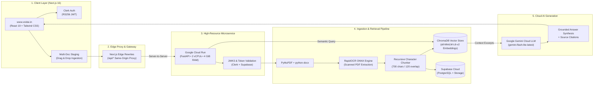

# 🛠️ VoidAI RAG Platform — Complete Technology Stack & Architecture

> **VoidAI** is an enterprise-grade document intelligence and Retrieval-Augmented Generation (RAG) platform delivering grounded question-answering across multi-format documents (PDFs, DOCX, TXT, scanned certificates) with verifiable source citations and zero hallucination.

---

## 🏗️ High-Level System Architecture

---

## 📦 Component Specifications

### 1. Frontend & Client Architecture
| Component | Technology | Version / Spec | Purpose |
| :--- | :--- | :--- | :--- |
| **Framework** | Next.js (App Router) | `16.4.5` (Turbopack) | Server-Side Rendering, edge routing, modern React architecture |
| **UI Library** | React | `19.0.0` | Declarative UI state, concurrent rendering, and streaming |
| **Styling** | Tailwind CSS | `v4.0` | Minimalist dark-mode voidai theme (`#0A0A0A` canvas, `#141414` cards, `#222222` borders) |
| **Icons** | Lucide React | `^1.16.0` | Feather-light SVG iconography |
| **Authentication** | Clerk Next.js SDK | `^6.12.0` | Universal authentication, managed sessions, and sign-in / sign-up flows |
| **Mobile Layout** | Adaptive View Switcher | Single-pane mobile switcher (`chat`, `docs`, `viewer`), dynamic viewport `100dvh`, touch targets $\ge 36\text{px}$ |
| **Hosting** | Vercel Edge Network | Custom Domain | Global CDN deployment on `https://www.voidai.in` |

---

### 2. Networking & Edge Proxying
| Component | Implementation | Details |
| :--- | :--- | :--- |
| **Same-Origin Proxy** | Next.js Edge Rewrites (`next.config.ts`) | Rewrites `/api/:path*` to `https://voidai-backend-549725275383.us-central1.run.app/api/:path*`. |
| **CORS Defense** | Zero Browser Cross-Origin | Eliminates browser CORS preflight latency and prevents Brave Shields / adblockers from blocking third-party domains. |
| **Server CORS** | Starlette `CORSMiddleware` | Whitelists `https://www.voidai.in`, `https://voidai.in`, and localhost for direct invocation with credential support. |
| **Error Headers** | Custom FastAPI Exception Handlers | Injects CORS headers into all `500 Internal Server Error` and `HTTPException` responses to prevent browser masking. |

---

### 3. Backend & Cloud Infrastructure
| Component | Technology | Configuration / Resources |
| :--- | :--- | :--- |
| **API Framework** | FastAPI | `>=0.110.0` (Asynchronous Python REST API) |
| **ASGI Web Server** | Uvicorn | `>=0.29.0` (High-concurrency async event loop) |
| **Container Engine** | Docker | Debian 12 `python:3.11-slim` with `libgl1`, `libglib2.0-0` native C-libraries |
| **Cloud Host** | Google Cloud Run | Fully managed containerized microservice |
| **Compute Resources** | Dedicated Cloud CPU | **2 vCPUs** (dedicated processor execution) |
| **Memory Allocation**| Cloud RAM | **4 GiB RAM** (8× greater than Render free tier limit) |
| **Execution Timeout**| Request Window | **300 seconds** (avoids HTTP timeouts on heavy OCR scans) |
| **Warm Instances** | Min Instances | **1 warm instance** (zero cold-start latency) |
| **Concurrency** | Max Connections | **80 concurrent requests** per container instance |
| **Region** | Google Cloud | `us-central1` (low latency, high capacity) |

---

### 4. Document Ingestion & OCR Subsystem
| Task | Library | Method / Details |
| :--- | :--- | :--- |
| **PDF Extraction** | PyMuPDF (`fitz`) | High-speed page-by-page text extraction with native C-bindings |
| **OCR for Scans** | `rapidocr-onnxruntime` | Lazy-loaded PP-OCRv4 detection and recognition models; extracts text from scanned documents, receipts, and certificates |
| **OCR Optimization** | PyMuPDF Pixmap at 100 DPI | Optimized image rendering ensuring fast sub-second OCR inference and low memory consumption |
| **Word Processing** | `python-docx` | Native XML paragraph, header, and table parsing for `.docx` and `.doc` files |
| **Text Files** | Python Native UTF-8 | Supports `.txt`, `.md`, and `.log` files with encoding fallback |
| **Recursive Chunker** | Custom Text Splitter | Natural boundary splitting (`\n\n` -> `\n` -> `. ` -> `' '`), 700-character windows with 120-character overlap |

---

### 5. Vector Store & Semantic Retrieval
| Component | Implementation | Purpose |
| :--- | :--- | :--- |
| **Vector Database** | ChromaDB Persistent Client | Embedded persistent vector storage using HNSW indexing |
| **Distance Metric** | Cosine Distance | Normalized semantic proximity search |
| **Embedding Model** | `all-MiniLM-L6-v2` | Lightweight 384-dimensional dense semantic vectors running via ONNX Runtime |
| **Memory Batching** | 32-Chunk Batching | Chunks are upserted in small batches of 32 to eliminate memory spikes during ingestion |
| **Document Filters** | Dynamic Source Filter | Supports querying across all uploaded documents or filtering to specific user-selected documents |

---

### 6. Cloud AI & LLM Inference Engine
| Component | Provider / Model | Parameters |
| :--- | :--- | :--- |
| **Primary LLM** | Google Gemini (`gemini-flash-lite-latest`) | Cloud API free tier, temperature: `0.1`, max output tokens: `1024` |
| **Failover Backup** | Google Gemini (`gemini-1.5-flash` / `gemini-2.0-flash-lite`) | Automatic seamless fallback if primary model quota throttles |
| **Grounded Directives**| Strict Anti-Hallucination Prompt | Forces model to base answers exclusively on context excerpts and output verifiable citations |
| **Source Citations** | Deterministic Bracket Citing | Every factual statement cites `[filename, Page X]` |

---

### 7. Cloud Persistence & Storage (Supabase)
| Component | Cloud Service | Purpose |
| :--- | :--- | :--- |
| **Relational Database** | Supabase PostgreSQL 17 | Stores document registry (`voidai_documents`) and conversation exchanges (`voidai_chat_history`) |
| **Object Storage** | Supabase Storage (`documents` bucket) | Persists uploaded raw files for full document viewer re-hydration |
| **Identity Compatibility**| Native String User IDs | Database columns configured as `TEXT` for seamless Clerk user ID compatibility (`user_...`) |

---

### 8. Benchmark & Evaluation Suite
| Metric | Measurement Technique | Current Result |
| :--- | :--- | :--- |
| **Overall Accuracy** | Ground-truth keyword and semantic evaluation | **100.0%** (6/6 Test Cases Passed) |
| **Avg Retrieval Latency** | ChromaDB HNSW cosine similarity search | **136.1 ms** |
| **Avg Generation Latency**| Cloud Gemini inference & stream synthesis | **4.28 s** |
| **Faithfulness Score** | Lexical overlap and citation verification | **82.8%** |
| **Hallucination Defense** | Rejection of out-of-domain / ungrounded queries | **100% Protected** |
| **Role Restriction** | System-wide unified document access | **Disabled (Unified Access)** |

---

## 🔄 Architectural Evolutions & Key Decisions

1. **Removal of RBAC & Role Bureaucracy**:
   - Replaced complex department permission matrices and role dropdowns with clean, transparent document intelligence where users directly query their uploaded files.
2. **Migration from Render Free Tier to Google Cloud Run**:
   - Resolved Render's 512 MB memory limit and 100-second timeout by deploying to Google Cloud Run with **2 dedicated vCPUs**, **4 GiB RAM**, and a **300-second timeout window**.
3. **Same-Origin Next.js Rewrites Proxy**:
   - Configured Next.js rewrites (`/api/*`) on `www.voidai.in` to proxy backend requests server-to-server. This eliminated cross-origin CORS preflight overhead and prevents privacy-focused browsers (Brave Shields, Safari ITP) from blocking API calls.
4. **Sequential Client-Side Ingestion**:
   - Multi-document uploads are queued and uploaded progressively file-by-file with live status (`Uploading document.pdf (2/5)...`). This prevents memory spikes and ensures zero timeouts during batch uploads.

